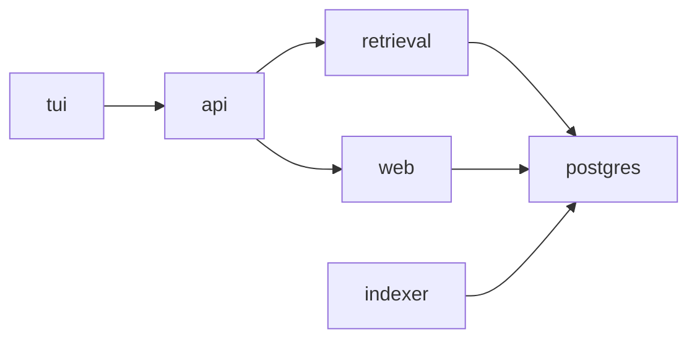

# Repo chat

This is a chat app for a git repo. The indexer clones it, chunks the files and commits, and stores embeddings in Postgres. Answers come from that index, and from the web when the question is outside the repo. Citations point at a file and line range, a commit, or a URL.



## Tech Stack

- Python 3.13, uv, and Hatchling
- just and Docker Compose
- Postgres 18 with pgvector and pg_trgm. The data volume is mounted at `/var/lib/postgresql`
- psycopg 3
- FastAPI, Textual, and httpx
- Pydantic
- tree-sitter
- Gemini: `gemini-embedding-2` at 1536 dimensions, and `gemini-3-flash-preview` for chat
- Tavily and trafilatura
- ruff and Pyright

## Chat

1. The router picks symbol search, semantic search, history search, and whether to call the web.
2. The query is rewritten. HyDE, when used, is embedded for vector search only.
3. Symbol search is trigram, for names like `getUserById`. Semantic search is pgvector plus full-text. History search hits commit messages and diffs, and stays in its own list until fusion.
4. The web runs when the router asked for it, or when the repo hits are empty or under `SCORE_FLOOR`. Tavily returns links. Allowlisted pages are fetched, extracted, chunked, and cached by content hash.
5. Reciprocal rank fusion merges the lists. One or more hits are reranked. Packing adds neighboring chunks and stops at a token budget.
6. One Gemini call writes the answer. The API streams tokens, then citations.

## Layout

Each package does one job. Apps depend only on what they call. There is no shared package.

```
packages/
  db/          pool, row types, SQL migrations
  jobs/        enqueue, claim, listen
  repogit/     clone, list files, diff, history
  chunking/    line windows, TypeScript tree-sitter, commit diffs
  embeddings/  Gemini embeddings
  llm/         Gemini chat
  retrieval/   symbol, full-text, vector, history, fusion, rerank, pack
  web/         Tavily search, fetch, extract, cache
apps/
  indexer/     claim jobs and store chunks
  api/         HTTP and the chat stream
  tui/         terminal client
```

## Run

Docker Desktop has to be running. From the repo root:

```powershell
just up
just migrate
uv run python -m indexer
uv run python -m api
uv run python -m tui
```
