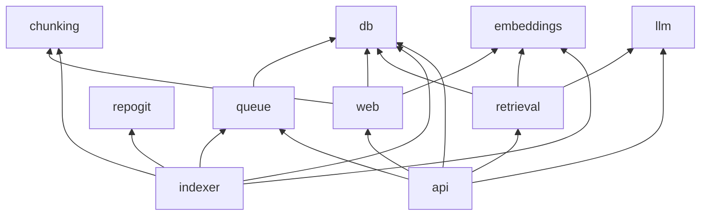
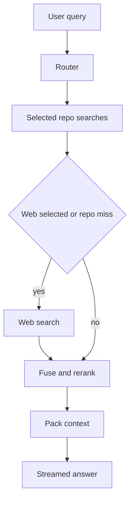

# Repo chat

Point it at a git repo. An indexer clones and chunks the code and history. Chat answers from retrieval over that index, plus live web search when the question is outside the repo. Citations point at files, line ranges, commits, or URLs.

Postgres with pgvector is the only infrastructure. It holds repos, chunks, embeddings, the job queue, and the web cache.

## Tech stack

- **Python 3.13**, **uv** workspace, **hatchling**
- **just** for commands. **Docker Compose** runs Postgres only. Apps run on the host through uv
- **Postgres 18** (`pgvector/pgvector:pg18`) with **pgvector** and **pg_trgm**. Mount the data volume at `/var/lib/postgresql`. Postgres 18 moved `PGDATA` under that directory; the old `/var/lib/postgresql/data` mount leaves data in an anonymous volume.
- **psycopg 3** (`psycopg[binary]`) and **psycopg-pool** for every query. Rows are dataclasses via `class_row`. `pgvector.psycopg.register_vector` registers the `vector` type
- Migrations are numbered `.sql` files applied by the `db` package
- **FastAPI**, **uvicorn**, **sse-starlette**
- **Textual** for the TUI
- **httpx** for the gateway, page fetches, and the TUI client
- **pydantic v2** for API bodies, settings, and the router decision
- **structlog**
- The **git** binary for clone, fetch, `ls-files`, and diff
- **tree-sitter** and **tree-sitter-language-pack**
- **Vercel AI Gateway** through httpx, using the chat-completions HTTP shape. `CHAT_MODEL` and `EMBEDDING_MODEL` are env vars. Start with OpenAI models on the gateway. Reranking is another gateway chat call
- **Brave Search API** for the result list, **trafilatura** to extract page text
- **ruff**, **pyright**, **pytest**. **GitHub Actions** runs Ruff and Pyright

## Workspace

Each concern is its own package. Apps depend only on what they call. There is no shared `core` package.

```
repo-chat/
├─ pyproject.toml                 # uv workspace
├─ docker-compose.yml             # postgres + pgvector
├─ justfile
├─ packages/
│  ├─ db/                         # pool, row types, SQL migrations
│  ├─ queue/                      # enqueue, claim, listen
│  ├─ repogit/                    # clone, walk, diff
│  ├─ chunking/                   # fixed, recursive, tree-sitter, commit/diff
│  ├─ embeddings/                 # gateway embed client, batching, content-hash skip
│  ├─ llm/                        # gateway chat client, streaming, prompts
│  ├─ retrieval/                  # repo search stages, fusion, rerank, packing
│  └─ web/                        # search, fetch, clean, cache
└─ apps/
   ├─ indexer/
   ├─ api/
   └─ tui/
```

The git helper is the `repogit` package. That name leaves the `git` import free for GitPython. Each package reads the env vars it needs. The connection pool lives in `db`.



The TUI is not in that graph. It talks to the API over HTTP and SSE and imports none of the packages.

`retrieval` does not import `web`, and `web` does not import `retrieval`. The API runs both and passes web hits into `retrieval.fuse`. Search SQL lives in `retrieval`. Queue SQL lives in `queue`. `db` is the pool, row types, and migrations.

## Apps

- **Indexer.** Claims jobs, clones or fetches, diffs against `last_indexed_commit`, chunks files and capped commit diffs, embeds, upserts. Skips gitignored paths, binaries, and lockfiles.
- **API.** `POST /repos`, `GET /repos/{id}`, `GET /jobs`, `POST /repos/{id}/chat` (SSE), `GET /health`. Chat runs the router, retrieval, maybe web, then the LLM, and streams tokens plus citations.
- **TUI.** Repo list with index status. Chat screen with streaming markdown, a retrieval trace, and citations. That screen is the one worth polishing.

## Database

`db` holds a `psycopg_pool` pool, dataclasses loaded with `class_row`, and numbered `.sql` files applied in order. Other packages take a connection and run their own SQL.

## Queue

`LISTEN` is tied to a connection, so the listen connection stays outside the pool. A pooled connection returned between queries would drop it.

Two connections per worker:

- **Listen.** One dedicated connection, `autocommit=True`, outside the pool. `LISTEN jobs`, then block on `conn.notifies(timeout=5)`. The timeout is the fallback poll. `NOTIFY` only carries a wake-up. The payload is not the job.
- **Claim.** A second, short transaction for `UPDATE jobs ... WHERE id = (SELECT id ... FOR UPDATE SKIP LOCKED LIMIT 1) RETURNING *`.

The indexer uses the sync connection. Job progress on the API uses a dedicated `psycopg.AsyncConnection` the same way.

Attempts, `run_after` backoff, and a reaper for stale locks. Job chain: `clone_repo`, then `index_files` and `index_commits`, then `embed_chunks`.

## Retrieval

This package is the deep end. Stages are plain functions: query plus `repo_id` in, ranked hits out. Adding a technique means adding a stage.

- Vector search on pgvector, filtered by `repo_id`. HNSW first, with an exact scan beside it so you can see what the index drops.
- Full-text on a `tsvector` column. Trigram on identifiers, because embeddings miss names like `getUserById`.
- History search over commit messages and capped diffs. Separate from code search. "Where is auth?" and "why did this change?" do not share a ranking.
- Reciprocal rank fusion across those lists. Rerank the fused top results with a gateway call.
- Query rewriting, multi-query, and HyDE in front of the selected stages. HyDE feeds the vector stage only.
- Context packing: neighbor chunks, dedup, token budget. Every hit carries a file and line range, or a commit sha.

Chunk text stays on `chunks`. Embeddings go on `chunk_embeddings(chunk_id, model, dims, vector)` so a second model is another row. Kind is `code`, `commit`, or `doc`.

## Web

Own tables: `web_pages` (url, domain, fetched_at, content hash) and `web_chunks` with their own embeddings. Web rows stay out of the repo HNSW index.

The router is one structured gateway call. Input is the question plus a short repo blurb (name, languages, top-level paths). Output is a Pydantic model: which of symbol, semantic, and history to run, whether to call web, and a web query string when it does. Web is for answers that are not in this repo: dependency docs, changelogs, version behavior, upstream errors. Repo questions stay off the web.

The API executes that decision. If the router skipped web and repo retrieval comes back empty or under a score floor, the API calls web anyway. That covers a router miss. The score floor is a knob, not a calibrated probability.

Brave returns the result list. httpx fetches allowlisted domains (docs, changelogs, GitHub issues). trafilatura extracts the text. The chunking package splits it, embeddings caches it by content hash. `fetched_at` shows stale docs. The API fuses web hits with repo hits only after both lists exist.

## Query flow

The repo is already indexed before a question arrives. A query does not clone or chunk the repo.



1. The TUI sends the question to `POST /repos/{id}/chat` and holds the SSE connection open.
2. The API loads the repo blurb. No search yet.
3. The router returns which repo stages run, whether to call web, and the web query.
4. Retrieval rewrites the query for those stages. HyDE, when used, is embedded and sent to vector search.
5. Symbol search is trigram. Semantic search is pgvector plus full-text. History search hits commits. Each hit carries a file and lines, or a commit sha.
6. Web runs when the router asked for it, or when repo hits are empty or under the score floor.
7. Reciprocal rank fusion merges the lists that ran. A gateway call reranks the top results.
8. Packing expands neighbors, drops duplicates, and fits a token budget.
9. One gateway call writes the answer. The API streams tokens, then citations. The trace is the router decision, the stages that ran, and the packed hits.

## Schema

- `repos`: url or path, default branch, status, last indexed commit
- `commits`: repo, sha, author, date, message
- `files`: repo, path, language, blob sha
- `chunks`: repo, file, lines, content, kind, content hash
- `chunk_embeddings`: chunk, model, dims, vector
- `jobs`: type, payload, status, attempts, run_after, lock fields, error
- `conversations`, `messages`: role, content, citations jsonb
- `web_pages`, `web_chunks`, `web_chunk_embeddings`

`repo_id` is on `chunks` so filtered vector search does not join.

## Build order

Detailed steps are in [TODO.md](TODO.md).

1. Workspace, compose, `db` migrations.
2. `queue`, then indexer: clone, fixed-size chunk, embed, store. Tree-sitter and commit chunks land in `chunking` as soon as the fixed-size path works.
3. `retrieval`: vector, then full-text, trigram, history, fusion, rerank, query rewriting.
4. `web`: fetch, cache, and fuse from the API.
5. Streaming chat, then the Textual repo list and chat screen.
